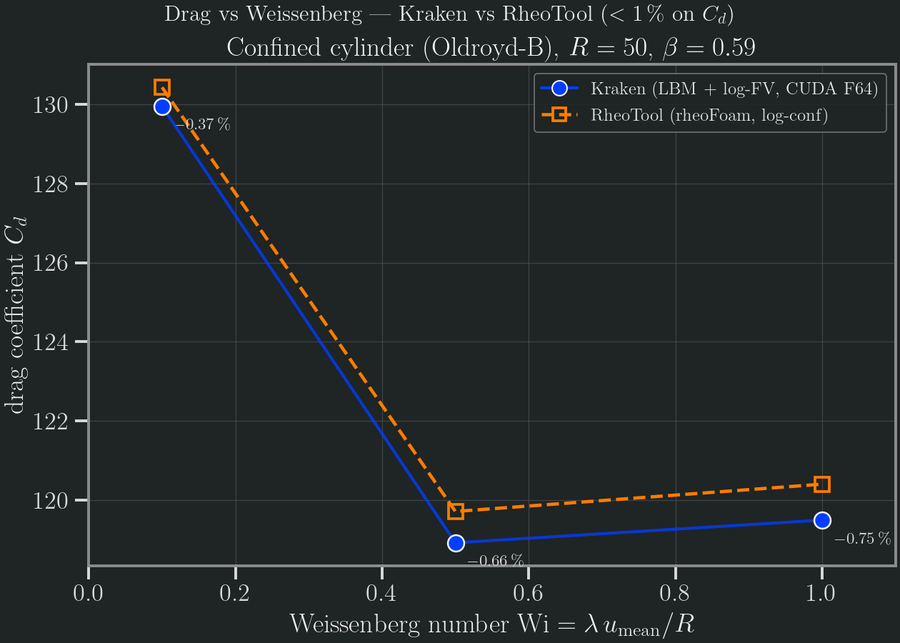

# Viscoelastic cylinder (Oldroyd-B)

Viscoelastic flow past a confined cylinder — the standard High-Weissenberg-Number-Problem
(HWNP) testbed of **Alves, Oliveira & Pinho (2001)**. At the production resolution
`R = 50`, Kraken's TRT-LBM cut-link drag matches **RheoTool** (rheoFoam, OpenFOAM-9,
log-conformation) to **better than 1 %** on the integrated drag coefficient `Cd` across
the validated range `Wi ≤ 1` at `β = 0.59` — `−0.75 %` at the most elastic point `Wi = 1`.

Kraken (filled markers + line), RheoTool (dashed + open squares); the elastic minimum
near `Wi ≈ 0.5` and the upturn toward `Wi = 1` are visible in both codes. The figure has
not been regenerated since the 2026-10-14 re-measurement and still plots the pre-fix
Kraken values (see the note below).



## Result

The strict **< 1 % on `Cd`** gate is met across `Wi ≤ 1` (R = 50, β = 0.59, Re = 1):

| Wi  | Kraken Cd | RheoTool Cd | rel. error  |
|-----|-----------|-------------|-------------|
| 0.1 | 129.95    | 130.43      | **−0.37 %** |
| 0.5 | 118.92    | 119.71      | **−0.66 %** |
| 1.0 | 119.49    | 120.40      | **−0.75 %** |

!!! note "Re-measured after the TRT Guo forcing fix (2026-10-14)"
    The `Cd` values on this page were re-measured on 2026-10-14 after the fix of the
    TRT Guo forcing (#67), which injected `g·F` per step instead of `F` (`g = 1.019` at
    the `ν = 0.15` used here). Same settings as job 22199679 (Aqua A100, CUDA Float64,
    300 000 steps). Post-fix source `edbc20916`: jobs 26763246/47/48 (`β = 0.59`,
    `R = 10/30/50`), 26766115 (`β` sweep), 26766116/26766117 (high-`Wi` staircase,
    `R = 50`/`R = 30`). Pre-fix control at `249146d4d` (job 26763249) gives
    `Cd = 119.2410` at `Wi = 1`, `R = 50`, the published value. At `β = 0.59` the fix
    moves `Cd` by +0.03 % to +0.23 % (`Wi = 0.1` to `1`, `R = 10` to `50`).

Kraken reproduces the **characteristic elastic signature** reported across the cylinder
literature (Alves–Oliveira–Pinho 2001; Hulsen et al. 2005; Claus & Phillips 2013): a
shallow minimum near `Wi ≈ 0.5` followed by an elastic upturn — not just a single
matched value. The agreement improves monotonically as the cylinder is resolved
(`Wi = 1`: −6.1 % / −1.7 % / −0.75 % at R = 10 / 30 / 50), confirming the residual gap
is discretisation, not modelling. Two independent methods (LBM + log-FV vs FV +
log-conformation) bracket the same benchmark. The earlier M8 study (2026-05-31,
`m8_refs/`) and the v0.3 re-validation agreed to 4–5 significant figures, both with the
pre-fix forcing; the values above differ from them by +0.03 % to +0.23 %. Full data:
`benchmarks/results/rheotool_compare/viscoelastic/error_norms.csv`.

## Methodology

**Kraken (TRT-LBM + log-conformation finite-volume polymer transport).** A D2Q9 TRT
collision for the flow; a separate finite-volume solver advects the matrix-logarithm of
the polymer conformation tensor (Fattal–Kupferman 2004) with MUSCL–superbee advection
and couples the extra-stress `τ_p = (ν_p/λ)(C − I)` back as a body force. Cylinder on
the channel centreline with a halfway bounce-back wall; the cut-link momentum-exchange
integrator measures the drag. Driver `run_viscoelastic_logfv_cylinder_coupled_2d`.

- **Geometry**: blockage `D/H = 0.5` (half-height `2R`), up/downstream length `15R`.
- **Fluid**: Oldroyd-B, `Re = 1`, solvent fraction `β = η_s/η₀ = 0.59` (the Boger value
  used throughout the cylinder literature).
- **Scaling**: diffusive (fixed `ν_total = 0.15`, `τ = 0.95`); `u_mean = ν_total·Re/R`,
  `λ = Wi·R/u_mean`.
- **Production run**: `R = 50` (diameter 100 LU), 300 000 steps, CUDA Float64
  (Aqua A100, job 22199679; re-measured with the same settings in jobs
  26763246/47/48, 2026-10-14).

**RheoTool `rheoFoam` (FVM reference).** OpenFOAM-9 base, `Cylinder/Oldroyd-BLog`
tutorial mesh, 2-core MPI to steady state at `t = 20`, matched `β = 0.59`, `Re = 1`,
`D/H = 0.5`.

**Reference.** M. A. Alves, P. J. Oliveira, F. T. Pinho (2001), *The flow of
viscoelastic fluids past a cylinder: finite-volume high-resolution methods*,
J. Non-Newtonian Fluid Mech. **97**, 207–232 — the canonical confined-cylinder HWNP
benchmark (cross-checked against Hulsen et al. 2005 and Claus & Phillips 2013).

## Caveats

- **N1 is a documented open difference, not a pass.** The wake first normal-stress
  difference `N1 = τ_xx − τ_yy` is qualitatively concordant (rises with `Wi`, rises as
  `β` decreases), but absolute wake-N1 maxima differ by up to ~30–45 % and the sign of
  the discrepancy changes with the parameters. An independent two-method derivation
  confirmed this is a genuine difference in the resolved wake-stress field, not a
  unit/convention artifact (every candidate reference stress cancels in the ratio). The
  integrated **drag** — the primary gate — matches to < 1 % at `β = 0.59`. See
  `m8_refs/N1_comparison.csv` (pre-fix ratios 0.770 / 0.704 / 0.890 / 1.437; after the
  #67 fix 0.771 / 0.705 / 0.894 / 1.448).
- **β ≤ 0.1 — both codes diverge.** Drag decreases as the polymer fraction grows
  (β = 0.59 → 0.30), and for β ≤ 0.1 Kraken returns NaN while RheoTool's PETSc solver
  aborts at `t ≈ 5`. This strongly-polymeric corner is a genuine physical/numerical
  boundary reproduced by both methods, not a solver-specific weakness.
- **β = 0.30 is outside the 1 % band.** At `R = 50` Kraken's `Cd` is 108.46 at
  `Wi = 0.5` (RheoTool 109.92, −1.33 %) and 108.61 at `Wi = 1` (RheoTool 107.28,
  +1.24 %). The RheoTool `β = 0.3`, `Wi = 1` run is not steady at `t = 20` (`Cd`
  109.7 → 106.8 → 107.3 over `t = 15–20`), so that cell is not a validation point.
- **High-Wi stability ≠ accuracy.** Kraken's halfway bounce-back cylinder is NaN-free up
  to `Wi = 10` (R = 30 and R = 50) — at or beyond the state of the art for LBM-based
  viscoelastic solvers (which typically ceiling near `Wi ≈ 1`). But these values are
  stable, not converged: the two resolutions diverge with `Wi` (131.6 vs 118.4 at
  Wi = 3) because `λ` grows very large and 300 000 steps no longer reach steady state.
  Only `Wi ≤ 1` is quantitatively validated.
- **Bouzidi-FL wall rejected.** A sub-cell linear-interpolation wall
  (Bouzidi–Filippova–Hänel, `wall = bouzidi_fl`) diverges (NaN) at the production
  resolution for `Wi ≥ 0.5` (R ≥ 50) and over-predicts drag where it survives on coarse
  grids, so halfway bounce-back is the validated default here.

## Reproduce

```julia
using Kraken
result = run_simulation("benchmarks/results/rheotool_compare/viscoelastic/cylinder_oldroyd_b.krk")
@show result.Cd   # coarse smoke (240×32, 20 steps) — NOT the R=50 table value
```

The shipped `.krk` is a quick smoke confirming the solver dispatches (returns a
non-converged `Cd`). The production tables (`R = 50`, 300 000 steps, CUDA Float64) were
produced on **Aqua (A100)** via `bench/viscoelastic_logfv/run_ve_revalidate_r50_halfwaybb.pbs`
(sweeping `Wi = 0.1/0.5/1.0` through `run_cyl_bigsweep_v2_2d.jl`) — they are **not**
CI-reproducible and require an A100-class run (job 22199679). Regenerate the figure with:

```bash
conda run -n kraken-v0-3-figures python \
  benchmarks/results/rheotool_compare/viscoelastic/plot.py
```

Data and the reproducibility bundle (Kraken/RheoTool CSVs, error norms, the M8
reference data, the `.krk`, and `plot.py`):
`benchmarks/results/rheotool_compare/viscoelastic/`.

## References

- M. A. Alves, P. J. Oliveira, F. T. Pinho (2001), *The flow of viscoelastic fluids
  past a cylinder: finite-volume high-resolution methods*, J. Non-Newtonian Fluid
  Mech. **97**, 207–232.
- M. A. Hulsen, R. Fattal, R. Kupferman (2005), *Flow of viscoelastic fluids past a
  cylinder at high Weissenberg number: stabilized simulations using matrix
  logarithms*, J. Non-Newtonian Fluid Mech. **127**, 27–39.
- R. Fattal, R. Kupferman (2004), *Constitutive laws for the matrix-logarithm of the
  conformation tensor*, J. Non-Newtonian Fluid Mech. **123**, 281–285.
- S. Claus, T. N. Phillips (2013), *Viscoelastic flow around a confined cylinder using
  spectral/hp element methods*, J. Non-Newtonian Fluid Mech. **200**, 131–146.
